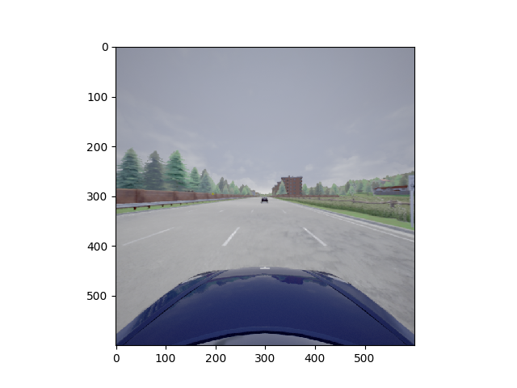
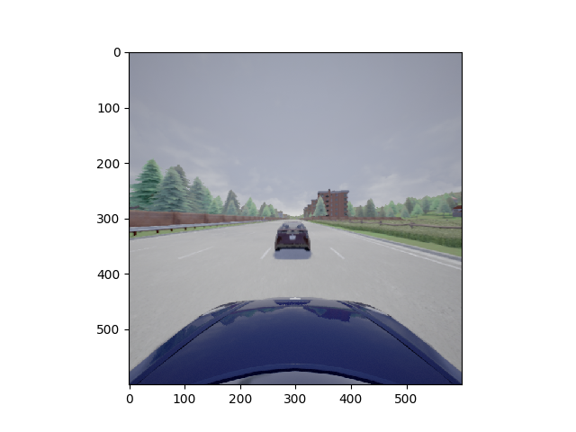
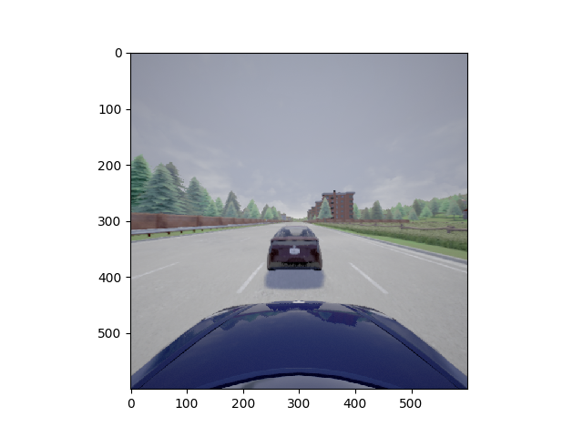

Mini-Project 2: Perception-based Adaptive Cruise Control in CARLA
=========================================

## Overview

In this part of the mini-project, we will estimate the distance between the host car and the lead car from video data and pass these estimated values to the ACC module created in Mini-Project 1.

The video data is already passed into the predictor model class. The image at each frame is a numpy array of size (600,600,3). Here are three examples:
<!--  {:height="36px" width="36px"} -->
<p align="center">

</p>


## Project Structure
```
csci513-miniproject2                    # root directory
  ├── camera_images                     # sample images to pass to distance NN
  ├── Carla.def                         # Definition file for Singularity
  ├── Carla.Dockerfile                  # Dockerfile to set up the CARLA simulator
  ├── dataset
  │   └── annotations.csv               # Training data: bounding boxes with ground-truth distances
  ├── HPC-Instructions.md
  ├── Makefile                          # Makefile to easily run things
  ├── mp2_controller
  │  ├── __init__.py
  │  └── controller.py                  # Copy the file you edited in Mini-Project 1. May need some updates.
  ├── mp2_distance_predictor
  │   ├── __init__.py
  │   ├── detect.py
  │   ├── distance_predictor.py
  │   ├── in_lane_predictor.py
  │   ├── train_distance_model.py       # THE FILE YOU NEED TO EDIT
  │   ├── train_in_lane_model.py        # THE FILE YOU NEED TO EDIT
  │   ├── distance_model.h5             # Created when you train the distance model
  │   ├── in_lane_model.h5              # Created when you train the lane model
  │   └── yolo.h5                       # Pretrained detection model (not in the archive, see Setup)
  ├── mp2_evaluation
  │   ├── __init__.py
  │   ├── __main__.py                   # Scripts to evaluate your controller
  ├── mp2_simulator
  │  ├── __init__.py
  │  ├── __main__.py                    # The test runner
  │  ├── misc.py
  │  ├── render.py
  │  └── simulator.py                   # An interface to the simulator
  ├── pyproject.toml
  ├── README.md
  ├── setup.cfg
  ├── setup.py
  └── test_data                         # The 15 test scenarios (same as Mini-Project 1)
```

## Task
Instead of the exact distance to the lead car your ACC controller now receives an estimated value inferred from an on-car camera image.
In each step of the simulation, the simulator will take the data from the camera sensor on-board the ego car, and pass it onto your `mp2_distance_predictor` module. The predicted distance is then passed back to the controller you designed in Mini-Project 1 (or a modified one) to safely control the vehicle.

In order to simplify the inference process, we've included an object detection model – YOLOv3 – that processes the latest camera image and tries to identify a bounding box for the car in frame. The hood of the ego car is visible at the bottom of every frame; the provided detection code already discards it, so the bounding box you receive is always a candidate lead car. The resulting bounding box, if present, is then passed onto two models you need to design and train.

The first model is a classifier that, given a bounding box, predicts whether or not the corresponding car is in ego lane. In case it's not, an `inf` distance is given to the controller, consistent with first part of the project.

The second model is a regression model predicting the distance when given the same bounding box. This model is only used if the car in the image was first successfully detected and then determined to be in ego lane. The output of this model is then given as distance value to the controller.

To train these models you're provided a dataset `dataset/annotations.csv` containing a collection
of bounding boxes detected in this exact setting along with the corresponding ground truth distance values.

You tasks:
  1. Modify `mp2_distance_predictor/train_in_lane_model.py` to define and train an appropriate lane classification model.
  2. Modify `mp2_distance_predictor/train_distance_model.py` to define and train an appropriate distance regression model.

The goal remains the same, your controller – now relying on your perception pipeline – should satisfy given specifications in given test scenarios. The exact files to hand in are listed under [What to submit](#what-to-submit).

Some useful resources:

- [Deep Learning In 60
  Minutes](https://pytorch.org/tutorials/beginner/deep_learning_60min_blitz.html)
- [Training an Object
  Detector](https://www.pyimagesearch.com/2021/11/01/training-an-object-detector-from-scratch-in-pytorch/)


## Setup

In all instances you need to have the following prerequisite packages installed:

1. Python 3.10
2. Pip >= 25

Use the same setup as in Mini-Project 1 for CARLA. If you are working on the HPC, follow
[HPC-Instructions.md](HPC-Instructions.md) instead of this section.

Mini-Project 1 used Python 3.8, and this project needs Python 3.10 together with new
libraries (TensorFlow, Keras, OpenCV). Create a **new** python environment for this project
rather than reusing the old one. Then, from the current project directory, run

```shell
$ pip install -e .
```
This command will install the project dependencies, and allow you to run the simulations
easily.

The pretrained YOLOv3 detector is not part of the archive because of its size. Place the
provided `yolo.h5` file at `mp2_distance_predictor/yolo.h5`. On the HPC, copy it from the
project directory as described in the HPC instructions. If you work on your own machine,
download it from the HPC first (about 250 MB; replace `<netid>` with your USC NetID):

```shell
$ scp <netid>@discovery.usc.edu:/project2/jdeshmuk_786/yolo.h5 mp2_distance_predictor/yolo.h5
```

Finally, copy your `controller.py` from Mini-Project 1 into `mp2_controller/controller.py`
and change its import line to `from mp2_simulator.simulator import Observation, Mode`.

## Training your models

The dataset `dataset/annotations.csv` has one row per camera frame with three columns:

- `frame_id`: index of the frame.
- `distance`: ground-truth distance to the lead car in meters, or `inf` if the lead car is not in the ego lane.
- `bbox`: the bounding box `[[xmin, ymin, xmax, ymax]]` (in pixels of the 600x600 image) that YOLOv3 detected for the car, or empty if nothing was detected.

Both training scripts read the dataset through a relative path and save the trained model
in the current directory, so they must be run **from inside** `mp2_distance_predictor/`:

```shell
$ cd mp2_distance_predictor
$ python3 train_in_lane_model.py     # writes in_lane_model.h5
$ python3 train_distance_model.py    # writes distance_model.h5
$ cd ..
```

The scripts run as provided, but the single-neuron models in them are placeholders and
will not perform well. Edit the section marked `Define your model architecture here`
(and anything else in these two files you like, such as input scaling or training settings).
Keep in mind how your models are called at simulation time:

- The lane model receives a numpy array of shape `(1, 4)` holding the bounding box and must output a single probability; the car is treated as in-lane if it is above 0.5.
- The distance model receives the same `(1, 4)` array and must output a single number, the distance in meters.
- Both are loaded with `keras.models.load_model`, so any preprocessing must be part of the saved model (for example a `Normalization` or `Rescaling` layer), not separate code in the training script.
- When compiling, spell the loss out in full (`'mean_squared_error'`, `'binary_crossentropy'`) as the provided scripts do. With this Keras version, a model compiled with the shorthand `'mse'` saves without complaint but then fails to load in the simulator with `Could not deserialize 'keras.metrics.mse'`.
- Before starting CARLA, you can check that a saved model loads with `python3 -c "from keras.models import load_model; load_model('mp2_distance_predictor/distance_model.h5')"` from the project root.

Training these small models does not need CARLA to be running.

## Running the simulations.

1. Start Carla, either from a terminal window (using Docker or otherwise) or by simply
   launching the CarlaUE4 executable.

```shell
$ ./CarlaUE4.sh -RenderOffScreen
```

2. In the other terminal, from the project root directory, start the controller:
```shell
$ python3 -m mp2_simulator test_data/*
```

The simulator loads `mp2_distance_predictor/yolo.h5`, `mp2_distance_predictor/in_lane_model.h5`,
and `mp2_distance_predictor/distance_model.h5` through relative paths, so it must be run from
the project root, and all three files must exist. Running YOLOv3 on every frame makes this
slower than Mini-Project 1.

You can also run the following to see what options you have for the test runner. 
```shell
$ python3 -m mp2_simulator --help
```

When you run the script, for every episode run by the script, it will save a CSV file in
the `logs/` directory. These CSV files (or _traces_) are a recording of the simulation
consisting of only the state variables we deem necessary for evaluating your design.
It also saves the on-board camera video of each episode in the `vids/` directory, which is
useful for seeing what your perception pipeline was looking at.

Note that the traces record the **true** distance to the lead car, not your estimate. Your
controller only ever sees the estimate, but it is evaluated against what actually happened.

## Evaluating your design

In this assignment, we will use Signal Temporal Logic (STL) requirements to ensure the
correctness of the controller. To do this, we use the [RT-AMT][rtamt] package (installed
automatically) to define offline monitors for your controller.

[rtamt]: https://github.com/nickovic/

To evaluate the traces you've captured for your controller, simply run the following
command:
```shell
$ python3 -m mp2_evaluation <list of log files>
```
where `<list of log files>` is a placeholder for all the CSV files you need to evaluate.
An example (assuming you are saving the files in `logs/` directory) would be:
```shell
$ python3 -m mp2_evaluation logs/*
```
which will evaluate all the files in that directory.

### Requirements being checked

The evaluator checks the same five requirements as in Mini-Project 1 on every trace. In the table, `d` is the true distance to the lead car, `v` is the ego velocity, `v_lead` is the lead car velocity, `v_des` is the desired cruise speed (20 m/s), and `mode` is the operation mode your controller reports (`FOLLOWING` = 1, `CRUISING` = 0). Each episode is 20 seconds long (200 steps of 0.1 s).

| Name | Requirement in words | Formal (STL) |
|---|---|---|
| `safeFollowing` | The ego car always keeps at least 4 m from the lead car. | `G (d >= 4)` |
| `forwardProgress` | The ego car never moves backwards. | `G (v >= 0)` |
| `dontStopUnlessLeadStops` | After t = 3 s, the ego car does not come to a stop (v < 0.1 m/s) while the lead car is still moving. | `G[3,3] not((v_lead > 0.1) U[0,20] (v < 0.1))` |
| `notFollowWhenFarAway` | Whenever the lead car is more than 40 m away, the controller switches to `CRUISING` within 2 s (unless the gap closes first). | `G[0,18] ((d > 40) -> F[0,2] (mode = CRUISING or d < 40))` |
| `reachTargetWhenNotFollowing` | Whenever the controller is in `CRUISING` mode, the ego car reaches within 2 m/s of `v_des` within 6 s (unless it switches to `FOLLOWING` first). | `G[0,14] (mode = CRUISING -> F[0,6] (abs(v - v_des) < 2 or mode = FOLLOWING))` |

**Important notes:**

- The distance `d` is measured **between the centers** of the two cars, not bumper to bumper. A collision ends the episode and sets `d` to 0, which fails `safeFollowing`. Since your distance estimate is now noisy, leave a larger margin than you did in Mini-Project 1.
- Your controller receives `inf` as the distance whenever no car is detected in the image or your lane model says the detected car is not in the ego lane. A missed detection of a car that is really there therefore looks exactly like an empty road, so your controller should be robust to occasional wrong estimates.
- The exact definitions are in `mp2_evaluation/__main__.py`. Do not modify that file.

### Grading

Your submission will be graded by running it on the **15 scenarios provided in `test_data/`** and checking the five requirements above on each resulting trace. This is exactly what `python3 -m mp2_simulator test_data/*` followed by `python3 -m mp2_evaluation logs/*` does, so you can compute your own score before submitting.

- Each requirement is worth **20%** of the grade.
- The score for a requirement is the fraction of the 15 scenarios on which it is satisfied, i.e. the `Fraction satisfied` value printed at the end of the evaluator output.
- A submission that satisfies all five requirements on all 15 scenarios receives full marks.

**Scores vary slightly from run to run.** Unlike Mini-Project 1, the same submission can pass a scenario in one run and fail it in the next, because small differences in the simulation change what the camera sees and therefore what your models predict. A design that passes with a comfortable margin gets the same score every time; a design that is close to a threshold does not. To keep this from costing you points through bad luck, **we will run each submission three times and keep the run with the highest total score.** Run your own design several times before submitting. If your score changes between runs, look at which scenarios flip and add margin there.

### What to submit

This project is done in the same groups as Mini-Project 1. It is due on **November 30, 2026**; submit on Brightspace, where the exact deadline time is shown.

Submit **one set of files per group**, as individual files (not a zip, and without renaming them):

| File | Where it lives in the project | Used for |
|---|---|---|
| `controller.py` | `mp2_controller/controller.py` | Graded |
| `in_lane_model.h5` | `mp2_distance_predictor/in_lane_model.h5` | Graded |
| `distance_model.h5` | `mp2_distance_predictor/distance_model.h5` | Graded |
| `train_in_lane_model.py` | `mp2_distance_predictor/train_in_lane_model.py` | Reference only, not run |
| `train_distance_model.py` | `mp2_distance_predictor/train_distance_model.py` | Reference only, not run |

The autograder copies the first three files into a clean copy of this project, together with our own copy of `yolo.h5`, so:

- Do not rename the `Controller` class or change the signature of `__init__` or `run_step`.
- Do not rely on changes to any other file in the project (for example `detect.py`, `in_lane_predictor.py`, or `distance_predictor.py`); they will not be present during grading. In particular, any input scaling or other preprocessing must be part of the saved model itself.
- Both models must load with a plain `keras.models.load_model(path)` in the project environment. Do not use custom layers, custom losses, or `Lambda` layers, since their code is not stored in the `.h5` file. Run the load check from the "Training your models" section on the exact files you submit.
- Do not import packages beyond those installed by `pip install -e .`.
- Your submission must run on all 15 scenarios without raising an exception. A crash on a scenario counts as failing all five requirements on that scenario, and a model that fails to load counts as a crash on every scenario.
- The two training scripts are not executed. We ask for them so that we can see how each model was produced.
- If you worked on the HPC, see "Downloading your files for submission" in [HPC-Instructions.md](HPC-Instructions.md) for how to copy the files to your own machine.
